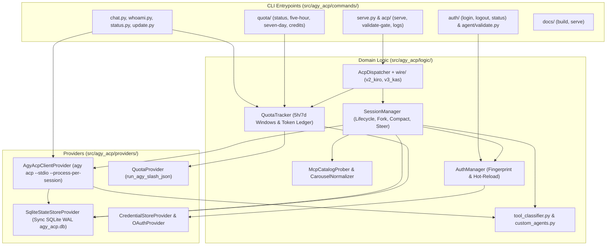

# Architecture & Component Design

`agy-acp` separates its external boundaries (`commands/` Cyclopts CLI and async stdio JSON-RPC 2.0 framing) from protocol/domain orchestration (`logic/`) and concrete infrastructure adapters (`providers/`).

## SOLID & GoF Pattern Application

1. **Adapter & Actor Supervisor (`AgyAcpClientProvider` + `_AcpSubprocessConnection`)**: Supervises a persistent `agy acp --stdio --process-per-session` subprocess inside an `anyio` structured-concurrency `TaskGroup`, decoupling full-duplex JSON-RPC multiplexing, crash auto-reconnect, and shielded POSIX process-group teardown (`os.killpg`) from `SessionManager`.
2. **Strategy (`EngineWireAdapter` — `v2_kiro.py` & `v3_kas.py`)**: Translates canonical session descriptors, tool calls, config options, steering lifecycle updates, and metadata into either Kiro ACP (`v2`) or Kiro Agent Server (`v3` / KAS) wire shapes without branching business logic.
3. **Mediator / Router (`AcpDispatcher` + Off-Loop `serve.py`)**: Routes inbound JSON-RPC requests and notifications concurrently while serializing outbound `stdout` frame batches off the event loop via `anyio.to_thread.run_sync` under an `anyio.Lock`.
4. **Chain of Policy & Security Containment (`tool_classifier.py` + `custom_agents.py`)**: Classifies `agy acp` native and MCP tool invocations into canonical ACP kinds, blocks native `agy` subagent tools when `kirocrew-core` `spawn_run` routing is active, enforces `.kiro/agents` `allowedTools` and path/command rules across both `tool_call` updates and `session/request_permission` callbacks, and validates `cwd`-contained regular files (`O_NOFOLLOW | O_NONBLOCK` + byte caps).
5. **Repository (`SqliteStateStoreProvider`)**: Persists sessions, turn history (`session_turns`), 24-hour TTL `models_cache`, cumulative `token_ledger`, and key-value state synchronously in SQLite WAL mode (`agy_acp.db`).
