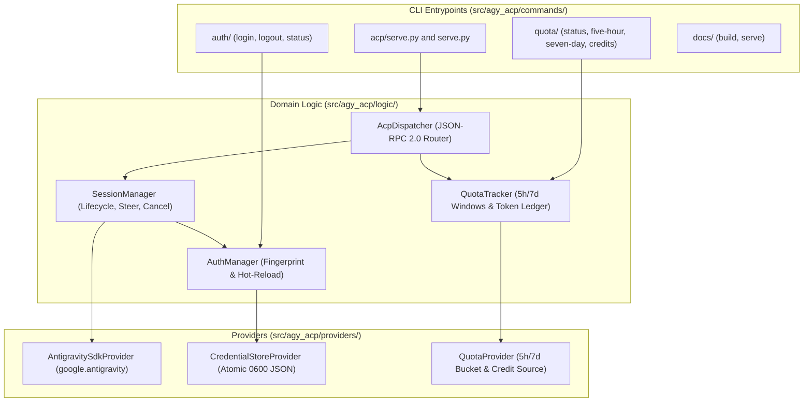

# Architecture & Component Design

`agy-acp` separates its rigid external boundaries (`commands/` CLI and ACP JSON-RPC 2.0 stdio framing) from its internal orchestration (`logic/`) and concrete infrastructure adapters (`providers/`).

## SOLID & GoF Pattern Application

1. **Adapter Pattern (`AntigravitySdkProvider`)**: Adapts `google.antigravity.Agent`, `LocalAgentConfig`, `CapabilitiesConfig`, `policy`, and `hooks` into an abstract session port consumed by `SessionManager`.
2. **Mediator / Router (`AcpDispatcher`)**: Decouples stdio framing and JSON-RPC request/response correlation (including server-to-client `session/request_permission` futures) from session execution.
3. **Strategy & Proxy (`AuthManager` + `CredentialStoreProvider`)**: Checks credential generation fingerprints before each turn and transparently rebinds the underlying SDK session (`SessionContinuationMode.RESUME`) when credentials change on disk.
4. **Observer (`@hooks.pre_tool_call_decide` & `@hooks.post_tool_call`)**: Streams real-time `tool_call` and `tool_call_update` notifications and gates tool execution on KiroCrew's `session/request_permission` response.
