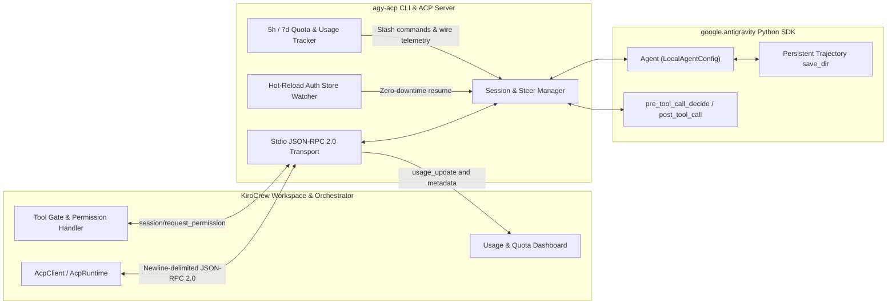

# agy-acp: Google Antigravity ACP Harness for KiroCrew

`agy-acp` wraps the [Google Antigravity Python SDK](https://github.com/google-antigravity/antigravity-sdk-python) (`google-antigravity`) in an **Agent Client Protocol (ACP)** JSON-RPC 2.0 server and Cyclopts CLI so that **KiroCrew** (`kiro_crew`) can orchestrate Google Antigravity agents as a drop-in ACP backend harness.

## Documentation Sections

- **[Requirements](requirements/overview.md)**: Complete external interface specification expected by KiroCrew, standalone CLI authentication with zero-downtime hot-reload, and 5-hour / 7-day rolling quota requirements.
- **[Verification Traceability Matrix](requirements/verification-matrix.md)**: Mapping from every requirement ID (`REQ-*`) to executable black-box `pytest` integration tests and unit tests.
- **[Design](design/architecture.md)**: Internal component boundaries, protocol translation, session resumption, and TDD implementation plan.
- **[Guides](guides/getting-started.md)**: Developer setup (`asdf`, `uv`, `pre-commit`, Python 3.15) and configuring KiroCrew to launch `agy-acp`.
- **[Runbooks](runbooks/auth-and-sessions.md)**: Operational procedures for credential rotation, session recovery, and quota exhaustion handling.
