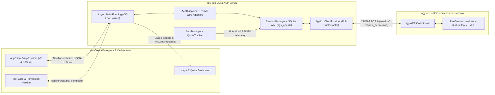

# agy-acp: Google Antigravity ACP Harness for KiroCrew

`agy-acp` bridges **KiroCrew** (`kiro_crew`) to the Google Antigravity CLI's native **`agy acp --stdio --process-per-session`** server through a full-duplex **Agent Client Protocol (ACP)** JSON-RPC 2.0 harness and Cyclopts CLI—supporting both Kiro v2 (`--agent-engine v2`) and KAS v3 (`--agent-engine v3`) wire contracts, zero-downtime auth hot-reload, `.kiro/agents` custom-agent sandboxing, and 5-hour / 7-day quota telemetry.

## Documentation Sections

- **[Requirements](requirements/overview.md)**: External interface specification expected by KiroCrew (`v2` Kiro ACP and `v3` KAS extensions), standalone CLI authentication with zero-downtime hot-reload, and 5-hour / 7-day rolling quota requirements.
- **[Verification Traceability Matrix](requirements/verification-matrix.md)**: Mapping from every requirement ID (`REQ-*`) and live `agy acp` subprocess contract to executable `pytest` integration and unit suites.
- **[Design](design/architecture.md)**: Component boundaries, full-duplex `agy acp` subprocess supervision, real-time permission gating, SQLite WAL persistence, and security containment.
- **[Guides](guides/getting-started.md)**: Developer setup (`asdf`, `uv`, `pre-commit`, Python 3.15) and configuring KiroCrew to launch `agy-acp`.
- **[Runbooks](runbooks/auth-and-sessions.md)**: Operational procedures for credential rotation, SQLite session recovery, ACP log inspection, and quota exhaustion handling.
