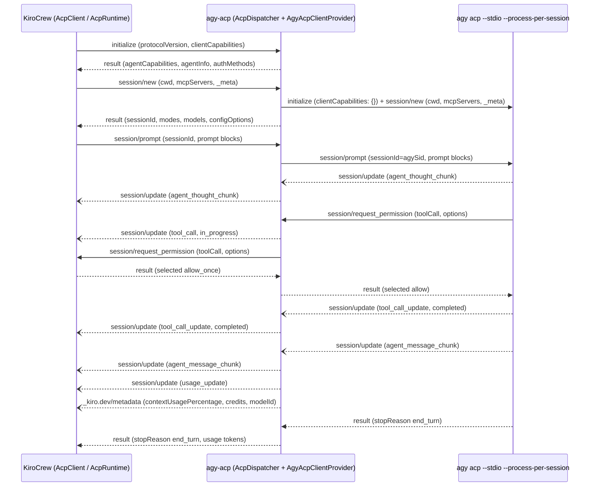

# ACP Harness External Interface Requirements

This specification documents every external interface point that **KiroCrew** (`kiro_crew`) expects when launching and communicating with an Agent Client Protocol (ACP) backend harness (`--agent-engine v2` Kiro ACP and `--agent-engine v3` KAS).

---

## 1. Transport, Process Model & CLI Invocation

### REQ-ACP-001: Stdio Newline-Delimited JSON-RPC 2.0 Transport & Framing
- **Transport**: The ACP server MUST read JSON-RPC 2.0 messages from `stdin` and write JSON-RPC 2.0 responses/notifications/requests to `stdout`, delimited by a single newline (`\n`) and encoded as UTF-8.
- **Stdout Purity**: Non-protocol output, debug logs, and tracebacks MUST NEVER be written to `stdout`; all diagnostics MUST go to `stderr`.
- **Frame Size Limit**: No single JSON-RPC line emitted to `stdout` may exceed **16 MiB** (`16,777,216` bytes, KiroCrew `_STDOUT_BUFFER_LIMIT` in `kiro_crew/acp/transport_framing.py`).
- **Stdin Drain & Off-Loop Output**: The server MUST drain `stdin` asynchronously and flush `stdout` frames off the event loop (`anyio.to_thread.run_sync` under an `anyio.Lock`) so client reads and writes never block concurrent tasks.

### REQ-ACP-002: CLI Entrypoint & KiroCrew Backend Adapter Compatibility
Because KiroCrew resolves ACP backend binaries via environment variable overrides (`CLAUDE_AGENT_ACP_BIN`, `CODEX_ACP_BIN`, `OPENCODE_BIN`, `GOOSE_BIN`, `PI_ACP_BIN`, `DSH_BIN`, `KIROCREW_KIRO_BIN`), `agy-acp` MUST support starting the ACP stdio server across all invocation patterns used by `kiro_crew/acp/launch.py`:

| Invocation Pattern | KiroCrew Backend Slot | Required CLI Support |
|---|---|---|
| `agy-acp acp serve` | Canonical `agy-acp` command | Starts ACP stdio server (`v2` default). |
| `agy-acp serve` | Top-level shorthand | Starts ACP stdio server. |
| `agy-acp acp serve --with-builtin developer` | `GOOSE_BIN` (`goose acp --with-builtin developer`) | Accepts `--with-builtin` flag and starts ACP stdio server. |
| `agy-acp acp serve --agent <name> [--model <id>] [--agent-engine v2\|v3] [--auth-method <m>]` | `KIROCREW_KIRO_BIN` (`kiro-cli acp ...`) | Accepts `--agent`, `--model`, `--agent-engine` (`v2` Kiro / `v3` KAS), `--auth-method` flags. |
| `agy-acp serve --profile acp [--patch <yml>]` | `DSH_BIN` (`dsh --profile acp --patch ...`) | Accepts `--profile` and `--patch` flags and performs gate marker handshake when `KIROCREW_DSH_GATE_SESSION` / `KIROCREW_DSH_GATE_MARKER` are set. |
| `agy-acp acp validate-gate` | Gate/config pre-flight check | Validates tool-gate configuration (`OPENCODE_CONFIG_CONTENT`, `GOOSE_MODE`, or gate marker). |

---

## 2. Protocol Handshake & Session Lifecycle



### REQ-ACP-003: `initialize` Handshake & Capability Negotiation
- **Request**: `method: "initialize"` with `params`:
  - `protocolVersion`: integer `1` or string `"2025-08-22"`.
  - `clientCapabilities`: `{"fs": {"readTextFile": false, "writeTextFile": false}, "terminal": false}`.
  - `clientInfo`: `{"name": "kiro-crew", "version": "..."}`.
  - `_meta`: optional Kiro metadata (`_meta.kiro.settings`).
- **Response**: MUST return within `90.0s`:
  ```json
  {
    "protocolVersion": 1,
    "agentCapabilities": {
      "loadSession": true,
      "mcpCapabilities": {
        "http": true,
        "sse": false
      },
      "promptCapabilities": {
        "image": true,
        "embeddedContext": true
      },
      "sessionCapabilities": {
        "close": {},
        "fork": {},
        "list": {},
        "resume": {}
      }
    },
    "agentInfo": {
      "name": "agy-acp",
      "title": "Google Antigravity ACP Harness",
      "version": "1.3.1"
    },
    "authMethods": []
  }
  ```
- **Client Capability Constraint**: Because KiroCrew sets `fs.readTextFile = false`, `fs.writeTextFile = false`, and `terminal = false` (and returns `-32601 Method not found` for `fs/*` and `terminal/*`), `agy-acp` initializes its downstream `agy acp` subprocess with `clientCapabilities: {}` so `agy acp` executes all filesystem and command tools internally via its built-in and MCP tools and NEVER invokes `fs/*` or `terminal/*` client RPCs.

### REQ-ACP-004: `session/new` Workspace Binding, MCP Projection & Config Options
- **Request**: `method: "session/new"` with `params`:
  - `cwd`: absolute path to workspace directory.
  - `mcpServers`: list of stdio servers (`{"name", "command", "args", "env": [{"name", "value"}]}`) and HTTP servers (`{"type": "http", "name", "url", "headers": [{"name", "value"}]}`).
  - `_meta`: optional `kiro.customAgents` or `claudeCode.options`.
- **Behavior**:
  - Persists session metadata in SQLite (`agy_acp.db`) and forwards `cwd`, per-session `mcpServers` (`env` and `headers` normalized as `[{"name", "value"}]` without touching `~/.gemini/config/mcp_config.json`), and `_meta.antigravity.systemPrompt.append` to `agy acp`.
  - If `KIROCREW_DSH_GATE_SESSION` and `KIROCREW_DSH_GATE_MARKER` are present in the environment, writes `"<nonce>\tloaded\n"` with `0600` permissions to `KIROCREW_DSH_GATE_MARKER` prior to returning from `session/new`.
- **Response**:
  - `sessionId`: non-empty string (`>= 32` alphanumeric/hyphen chars matching `^[a-zA-Z0-9-]+$`).
  - `modes`: `{"currentModeId": "<mode>", "availableModes": [...]}` (honoring `GOOSE_MODE="approve"` and `.kiro/agents` custom agent profiles).
  - `models`: `{"currentModelId": "<model_id>", "availableModels": [{"modelId": "...", "name": "...", "description": "..."}]}`.
  - `configOptions`: `model`, `mode` (or KAS `v3` `effortLevel`), and `reasoning_effort` (`low` / `medium` / `high`).

### REQ-ACP-005: `session/load` Native Session Persistence & Resumption
- **Request**: `method: "session/load"` with `params: {"sessionId": "<sid>", "cwd": "<path>", "mcpServers": [...]}`.
- **Behavior**:
  - Restores session state from SQLite (`agy_acp.db`) and resumes the mapped `agy acp` backend session via `session/load` (falling back cleanly to a fresh backend session seeded with `[Compacted Session Summary]` when upstream state is absent or profile-evicted).
  - Emits current state notifications (`config_option_update`, `current_mode_update`, `available_commands_update`, `_kiro.dev/metadata`, plus stored replay turns) and returns the restored session descriptor (`sessionId`, `modes`, `models`, `configOptions`).
  - If `sessionId` does not exist, returns a JSON-RPC error (`-32002` or `-32602` session not found).

### REQ-ACP-006: Multiplexed & Per-Session Runtime Topologies
- `agy-acp` MUST support maintaining multiple concurrent `sessionId`s within a single stdio process (`agy acp --stdio --process-per-session`) as well as single-session processes.
- All outgoing `session/update` notifications and `session/request_permission` requests MUST include the exact `sessionId` of the originating session.

---

## 3. Configuration Mutation, Streaming Prompts & Tool Gating

### REQ-ACP-007: `session/set_mode`, `session/set_model`, and `session/set_config_option`
- **`session/set_mode`**:
  - Request `params`: `{"sessionId": "<sid>", "modeId": "<mode_id>"}`.
  - Valid `modeId` values update the session's tool approval policy (`"read-only"`, `"approve"`, `"auto"`, or a `.kiro/agents` custom agent mode), synchronize `agy acp` `session/set_config_option` (`mode`), emit a `session/update` with `{"sessionUpdate": "current_mode_update", "currentModeId": "<mode_id>"}`, and return `{}`.
  - Unknown `modeId` returns JSON-RPC error `-32603` with `data: "Mode '<mode_id>' not found"`.
- **`session/set_model`**:
  - Request `params`: `{"sessionId": "<sid>", "modelId": "<model_id>"}`.
  - Updates active model via `agy acp` `session/set_model` and returns `{}`.
- **`session/set_config_option`**:
  - Request `params`: `{"sessionId": "<sid>", "configId": "model" | "mode" | "reasoning_effort" | "thought_level" | "thinkingLevel" | "effortLevel", "value": "<val>"}`.
  - Updates the corresponding session setting (`model`, approval `mode`, or `thought_level` `low` / `medium` / `high`) and returns `{"configOptions": [...]}` reflecting the updated `currentValue`.

### REQ-ACP-008: `session/prompt` Turn Execution (Text, Thoughts, Images & Skill Injection)
- **Request**: `method: "session/prompt"` with `params`:
  - `sessionId`: target session ID.
  - `prompt`: list of content blocks:
    - `{"type": "text", "text": "..."}` (including KiroCrew's injected `<kiro-skill-catalog>` XML blocks, `cwd`-contained Markdown image links converted in memory, or slash commands like `/quota`, `/usage`, `/credits`, `/compact`).
    - `{"type": "image", "data": "<base64>", "mimeType": "image/png" | "image/jpeg" | "image/gif" | "image/webp" | "image/bmp"}` (forwarded inline as ACP `image` content blocks without staging temporary files).
- **Streaming Notifications (`method: "session/update"`)**:
  - Streams `agent_thought_chunk` and `agent_message_chunk` notifications (with carousel normalization when applicable) and resolves with `{"stopReason": "end_turn", "usage": {"inputTokens": ..., "outputTokens": ..., "cachedReadTokens": ..., "cachedWriteTokens": ...}}`.

### REQ-ACP-009: Tool Call Lifecycle & `session/request_permission` Approval Gating
- **Tool Start (`tool_call`)**:
  - When `agy acp` announces a tool call (`tool_call` or `session/request_permission`), `agy-acp` classifies it via `tool_classifier.py` and emits `session/update` (`status="in_progress"`, deduplicated per `toolCallId`).
- **Permission Request (`session/request_permission`)**:
  - Re-evaluates populated `rawInput` against native-subagent blocking (`invoke_subagent`, `define_subagent`, `manage_subagents` when KiroCrew `spawn_run` routing is active), `.kiro/agents` `allowedTools` + path/command rules, and KiroCrew's upstream `session/request_permission`.
  - Replies fail-closed to `agy acp` with `allow_once` or `reject_once` without killing the `agy acp` worker process.
- **Tool Completion (`tool_call_update`)**:
  - Emits `session/update` with `sessionUpdate: "tool_call_update"` (`status="completed"` or `"failed"`).

### REQ-ACP-010: Mid-Turn Steer (`_session/steer`, `_session/steering`, Overlap) & Cancellation (`session/cancel`)
- **Cancellation (`session/cancel`)**:
  - Forwards `session/cancel` to `agy acp` and resolves the in-flight `session/prompt` request within `5.0s` (`_CANCEL_DRAIN_TIMEOUT`) with `{"stopReason": "cancelled"}`.
- **Mid-Turn Steer**:
  - Emits wire-appropriate steering notifications (`steering_queued` / `steering_applied` / `steering_cleared`), cancels the active `agy acp` leg, replays the steered prompt blocks, and persists steered user blocks in `session_turns`.

### REQ-ACP-011: Session Fork, Checkpoint Revert, Compaction & Teardown RPCs
- Supports `session/fork`, `_kiro/checkpoint/revertMultiple`, and `_kiro/session/compact` via SQLite `session_turns` + `[Compacted Session Summary]` while preserving `_meta.antigravity.systemPrompt.append`.
- Handles all three KiroCrew session teardown methods (`session/close`, `_kiro.dev/session/terminate`, `_kiro/session/delete`) by sending `session/close` to `agy acp` and updating/purging SQLite session state.
