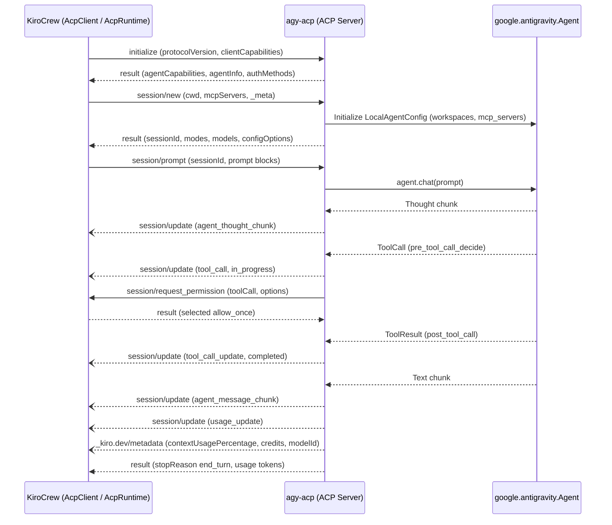

# ACP Harness External Interface Requirements

This specification documents every external interface point that **KiroCrew** (`kiro_crew`) expects when launching and communicating with an Agent Client Protocol (ACP) backend harness.

---

## 1. Transport, Process Model & CLI Invocation

### REQ-ACP-001: Stdio Newline-Delimited JSON-RPC 2.0 Transport & Framing
- **Transport**: The ACP server MUST read JSON-RPC 2.0 messages from `stdin` and write JSON-RPC 2.0 responses/notifications/requests to `stdout`, delimited by a single newline (`\n`) and encoded as UTF-8.
- **Stdout Purity**: Non-protocol output, debug logs, and tracebacks MUST NEVER be written to `stdout`; all diagnostics MUST go to `stderr`.
- **Frame Size Limit**: No single JSON-RPC line emitted to `stdout` may exceed **16 MiB** (`16,777,216` bytes, KiroCrew `_STDOUT_BUFFER_LIMIT` in `kiro_crew/acp/transport_framing.py`).
- **Stdin Drain Bound**: The server MUST drain `stdin` asynchronously so client writes complete well within KiroCrew's 5.0-second write bound (`_RESPONSE_WRITE_BOUND_SECS`).

### REQ-ACP-002: CLI Entrypoint & KiroCrew Backend Adapter Compatibility
Because KiroCrew resolves ACP backend binaries via environment variable overrides (`CLAUDE_AGENT_ACP_BIN`, `CODEX_ACP_BIN`, `OPENCODE_BIN`, `GOOSE_BIN`, `PI_ACP_BIN`, `DSH_BIN`, `KIROCREW_KIRO_BIN`), `agy-acp` MUST support starting the ACP stdio server across all invocation patterns used by `kiro_crew/acp/launch.py`:

| Invocation Pattern | KiroCrew Backend Slot | Required CLI Support |
|---|---|---|
| `agy-acp acp serve` | Canonical `agy-acp` command | Starts ACP stdio server. |
| `agy-acp serve` | Top-level shorthand | Starts ACP stdio server. |
| `agy-acp acp serve --with-builtin developer` | `GOOSE_BIN` (`goose acp --with-builtin developer`) | Accepts `--with-builtin` flag and starts ACP stdio server. |
| `agy-acp acp serve --agent <name> [--model <id>] [--agent-engine <v>] [--auth-method <m>]` | `KIROCREW_KIRO_BIN` (`kiro-cli acp ...`) | Accepts `--agent`, `--model`, `--agent-engine`, `--auth-method` flags. |
| `agy-acp serve --profile acp [--patch <yml>]` | `DSH_BIN` (`dsh --profile acp --patch ...`) | Accepts `--profile` and `--patch` flags and performs gate marker handshake when `KIROCREW_DSH_GATE_SESSION` / `KIROCREW_DSH_GATE_MARKER` are set. |
| `agy-acp acp validate-gate` | Gate/config pre-flight check | Validates tool-gate configuration (`OPENCODE_CONFIG_CONTENT`, `GOOSE_MODE`, or gate marker). |

---

## 2. Protocol Handshake & Session Lifecycle



### REQ-ACP-003: `initialize` Handshake & Capability Negotiation
- **Request**: `method: "initialize"` with `params`:
  - `protocolVersion`: integer `1` or string `"2025-08-22"`.
  - `clientCapabilities`: `{"fs": {"readTextFile": false, "writeTextFile": false}, "terminal": false}`.
  - `clientInfo`: `{"name": "kiro-crew", "version": "..."}`.
  - `_meta`: optional Kiro metadata (`_meta.kiro.settings`).
- **Response**: MUST return within `90.0s`:
  ```json
  {
    "protocolVersion": 1,
    "agentCapabilities": {
      "loadSession": true,
      "mcpCapabilities": {
        "http": true,
        "sse": false
      },
      "promptCapabilities": {
        "image": true,
        "embeddedContext": true
      },
      "sessionCapabilities": {
        "close": {},
        "fork": {},
        "list": {},
        "resume": {}
      }
    },
    "agentInfo": {
      "name": "agy-acp",
      "title": "Google Antigravity ACP Harness",
      "version": "0.1.0"
    },
    "authMethods": []
  }
  ```
- **Client Capability Constraint**: Because KiroCrew sets `fs.readTextFile = false`, `fs.writeTextFile = false`, and `terminal = false` (and returns `-32601 Method not found` for `fs/*` and `terminal/*`), `agy-acp` MUST execute all filesystem and command tools internally via `google.antigravity` builtin/MCP tools and NEVER invoke `fs/*` or `terminal/*` client RPCs.

### REQ-ACP-004: `session/new` Workspace Binding, MCP Projection & Config Options
- **Request**: `method: "session/new"` with `params`:
  - `cwd`: absolute path to workspace directory.
  - `mcpServers`: list of stdio servers (`{"name", "command", "args", "env": [{"name", "value"}]}`) and HTTP servers (`{"type": "http", "name", "url", "headers": [{"name", "value"}]}`).
  - `_meta`: optional `kiro.customAgents` or `claudeCode.options`.
- **Behavior**:
  - Translates `cwd` into `LocalAgentConfig(workspaces=[cwd])`.
  - Translates stdio entries in `mcpServers` into `google.antigravity.types.McpStdioServer` (converting `env` list of `{"name", "value"}` dicts into `dict[str, str]`) and HTTP entries into `McpStreamableHttpServer` (converting `headers` list into `dict[str, str]`).
  - If `KIROCREW_DSH_GATE_SESSION` and `KIROCREW_DSH_GATE_MARKER` are present in the environment, writes `"<nonce>\tloaded\n"` with `0600` permissions to `KIROCREW_DSH_GATE_MARKER` prior to returning from `session/new`.
- **Response**:
  - `sessionId`: non-empty string (`>= 32` alphanumeric/hyphen chars matching `^[a-zA-Z0-9-]+$`).
  - `modes`: `{"currentModeId": "<mode>", "availableModes": [{"id": "auto", "name": "Auto"}, {"id": "approve", "name": "Approve"}, {"id": "read-only", "name": "Read Only"}]}` (honoring `GOOSE_MODE="approve"` when set).
  - `models`: `{"currentModelId": "<model_id>", "availableModels": [{"modelId": "...", "name": "...", "description": "..."}]}`.
  - `configOptions`:
    - `{"id": "model", "name": "Model", "category": "model", "type": "select", "currentValue": "...", "options": [...]}`
    - `{"id": "mode", "name": "Approval Mode", "category": "mode", "type": "select", "currentValue": "...", "options": [{"value": "read-only", "name": "Read Only"}, {"value": "approve", "name": "Approve"}, {"value": "auto", "name": "Default"}]}`
    - `{"id": "reasoning_effort", "name": "Reasoning Effort", "category": "thought_level", "type": "select", "currentValue": "medium", "options": [{"value": "low", "name": "Low"}, {"value": "medium", "name": "Medium"}, {"value": "high", "name": "High"}]}`

### REQ-ACP-005: `session/load` Native Session Persistence & Resumption
- **Request**: `method: "session/load"` with `params: {"sessionId": "<sid>", "cwd": "<path>", "mcpServers": [...]}`.
- **Behavior**:
  - Re-attaches to the persistent `save_dir` using `LocalAgentConfig(conversation_id=sessionId, session_continuation_mode=SessionContinuationMode.RESUME, save_dir=...)`.
  - Emits current state notifications (`config_option_update`, `current_mode_update`, `available_commands_update`, `_kiro.dev/metadata`) and returns the restored session descriptor (`sessionId`, `modes`, `models`, `configOptions`).
  - If `sessionId` does not exist, returns a JSON-RPC error (`-32002` or `-32602` session not found).

### REQ-ACP-006: Multiplexed & Per-Session Runtime Topologies
- `agy-acp` MUST support maintaining multiple concurrent `sessionId`s within a single stdio process (as used by KiroCrew's `AcpRuntime` + `AcpSessionHandle`) as well as single-session processes (as used by KiroCrew's `AcpClient`).
- All outgoing `session/update` notifications and `session/request_permission` requests MUST include the exact `sessionId` of the originating session.

---

## 3. Configuration Mutation, Streaming Prompts & Tool Gating

### REQ-ACP-007: `session/set_mode`, `session/set_model`, and `session/set_config_option`
- **`session/set_mode`**:
  - Request `params`: `{"sessionId": "<sid>", "modeId": "<mode_id>"}`.
  - Valid `modeId` values update the session's tool approval policy (`"read-only"` -> `BuiltinTools.read_only()` / deny writes; `"approve"` -> `policy.ask_user`; `"auto"` -> `policy.allow_all()` minus any denied patterns), emit a `session/update` with `{"sessionUpdate": "current_mode_update", "currentModeId": "<mode_id>"}`, and return `{}`.
  - Unknown `modeId` returns JSON-RPC error `-32603` with `data: "Mode '<mode_id>' not found"`.
- **`session/set_model`**:
  - Request `params`: `{"sessionId": "<sid>", "modelId": "<model_id>"}`.
  - Updates active model on the session and returns `{}`.
- **`session/set_config_option`**:
  - Request `params`: `{"sessionId": "<sid>", "configId": "model" | "mode" | "reasoning_effort" | "thought_level" | "thinkingLevel", "value": "<val>"}`.
  - Updates the corresponding session setting (`ModelTarget`, approval mode, or `ThinkingLevel.LOW` / `MEDIUM` / `HIGH`) and returns `{"configOptions": [...]}` reflecting the updated `currentValue`.

### REQ-ACP-008: `session/prompt` Turn Execution (Text, Thoughts, Images & Skill Injection)
- **Request**: `method: "session/prompt"` with `params`:
  - `sessionId`: target session ID.
  - `prompt`: list of content blocks:
    - `{"type": "text", "text": "..."}` (including KiroCrew's injected `<kiro-skill-catalog>` XML blocks or slash commands like `/quota`, `/usage`, `/credits`).
    - `{"type": "image", "data": "<base64>", "mimeType": "image/png" | "image/jpeg" | "image/gif" | "image/webp" | "image/bmp"}` (converted via `google.antigravity.Image` / `from_bytes`).
- **Streaming Notifications (`method: "session/update"`)**:
  - For each reasoning/thinking delta (`Thought` chunk):
    ```json
    {
      "jsonrpc": "2.0",
      "method": "session/update",
      "params": {
        "sessionId": "<sid>",
        "update": {
          "sessionUpdate": "agent_thought_chunk",
          "content": {"type": "text", "text": "<thought_delta>"}
        }
      }
    }
    ```
  - For each response text delta (`Text` chunk):
    ```json
    {
      "jsonrpc": "2.0",
      "method": "session/update",
      "params": {
        "sessionId": "<sid>",
        "update": {
          "sessionUpdate": "agent_message_chunk",
          "content": {"type": "text", "text": "<text_delta>"}
        }
      }
    }
    ```
- **Turn Completion Response**:
  ```json
  {
    "stopReason": "end_turn",
    "usage": {
      "inputTokens": 1200,
      "outputTokens": 350,
      "cachedReadTokens": 800,
      "cachedWriteTokens": 0
    }
  }
  ```

### REQ-ACP-009: Tool Call Lifecycle & `session/request_permission` Approval Gating
- **Tool Start (`tool_call`)**:
  - When `google.antigravity` starts a tool call, emit `session/update`:
    ```json
    {
      "sessionUpdate": "tool_call",
      "toolCallId": "<id>",
      "title": "<tool_name>",
      "kind": "execute | edit | write | read | think | other",
      "status": "in_progress",
      "rawInput": { ... },
      "_meta": {
        "kiro": {
          "mcpServerName": "<server_name_if_mcp>",
          "toolName": "<tool_name>"
        }
      }
    }
    ```
- **Permission Request (`session/request_permission`)**:
  - When the tool requires approval (e.g. `mode == "approve"`, or `OPENCODE_CONFIG_CONTENT` / `.claude/settings.local.json` / default policy requires confirmation), send a JSON-RPC request (`id` assigned by server) to KiroCrew:
    ```json
    {
      "jsonrpc": "2.0",
      "id": "perm_1",
      "method": "session/request_permission",
      "params": {
        "sessionId": "<sid>",
        "toolCall": {
          "toolCallId": "<id>",
          "title": "<tool_name>",
          "kind": "execute",
          "rawInput": { ... }
        },
        "options": [
          {"optionId": "allow_once", "name": "Allow once", "kind": "allow_once"},
          {"optionId": "allow_always", "name": "Always allow", "kind": "allow_always"},
          {"optionId": "reject_once", "name": "Reject", "kind": "reject_once"}
        ]
      }
    }
    ```
  - If KiroCrew responds with `{"outcome": {"outcome": "selected", "optionId": "allow_once" | "allow_always"}}`, allow the tool in `@hooks.pre_tool_call_decide`.
  - If KiroCrew responds with `optionId: "reject_once"` or `{"outcome": {"outcome": "cancelled"}}`, deny the tool in `@hooks.pre_tool_call_decide` (`HookResult(allow=False, message="Rejected by user")`).
- **Tool Completion (`tool_call_update`)**:
  - When `@hooks.post_tool_call` fires, emit `session/update`:
    ```json
    {
      "sessionUpdate": "tool_call_update",
      "toolCallId": "<id>",
      "status": "completed",
      "kind": "execute",
      "content": [
        {"type": "content", "content": {"type": "text", "text": "<output>"}}
      ],
      "rawOutput": {
        "result": {
          "content": [{"type": "text", "text": "<output>"}]
        }
      }
    }
    ```

### REQ-ACP-010: Mid-Turn Steer (`session/prompt` Overlap) & Cancellation (`session/cancel`)
- **Cancellation (`session/cancel`)**:
  - KiroCrew sends a JSON-RPC notification `{"jsonrpc": "2.0", "method": "session/cancel", "params": {"sessionId": "<sid>"}}` (no `id`).
  - `agy-acp` MUST invoke `await response.cancel()` on the active `google.antigravity` turn and resolve the in-flight `session/prompt` request within `5.0s` (`_CANCEL_DRAIN_TIMEOUT`) with `{"stopReason": "cancelled"}`.
- **Mid-Turn Steer (Overlapping `session/prompt`)**:
  - When KiroCrew sends a second `session/prompt` on the same `sessionId` while a turn is already active, `agy-acp` MUST emit `session/update` with `{"sessionUpdate": "steer_queued"}`, deliver the follow-up prompt after or into the active turn (`{"sessionUpdate": "steer_delivered"}`), and resolve both `session/prompt` requests cleanly.

### REQ-ACP-011: Session Close & Termination RPCs
- `agy-acp` MUST handle all three KiroCrew session teardown methods and return `{}` after closing the session's `Agent` instance:
  - `session/close` (`params: {"sessionId": "<sid>"}`)
  - `_kiro.dev/session/terminate` (`params: {"sessionId": "<sid>"}`)
  - `_kiro/session/delete` (`params: {"sessionId": "<sid>"}`)
