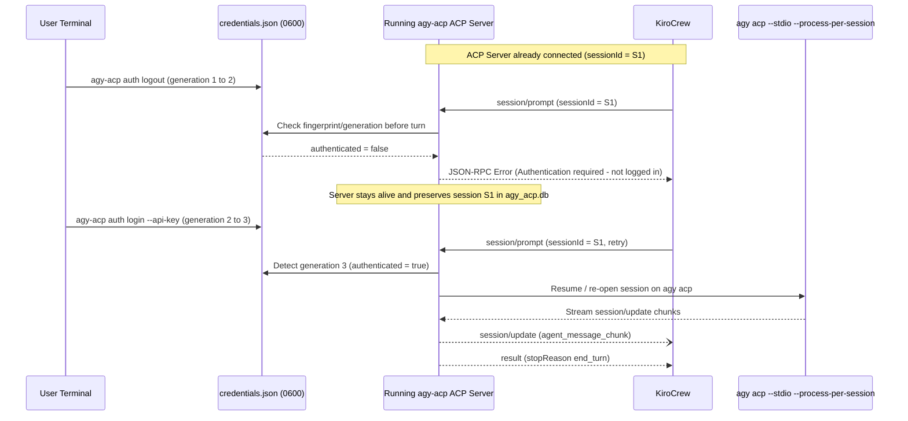

# CLI Authentication & Zero-Downtime Hot-Reload Requirements

KiroCrew never calls the ACP `authenticate` JSON-RPC method. Instead, KiroCrew expects the agent harness to manage its own credential store (`own_credential_file`) and detect signed-out states via standardized error messages. Furthermore, `agy-acp` allows users to log in or log out from a separate CLI invocation without restarting an already-connected `agy-acp` ACP server.

---

## 1. Out-of-Band CLI Authentication Commands

### REQ-AUTH-001: Standalone CLI Login (`agy-acp auth login`)
- **Command**: `agy-acp auth login [--api-key <key>] [--vertex] [--project <project_id>] [--location <region>] [--oauth] [--auth-file <path>] [--format json|text]`
- **Behavior**:
  - Authenticates and validates credentials (API key, Vertex AI ADC/project/location, or Antigravity OAuth via `OAuthProvider`).
  - Writes the credential record atomically (via temporary file + `os.replace` with `0600` permissions) to the credential store (`AGY_ACP_AUTH_FILE` or default `~/.config/agy-acp/credentials.json`).
  - Increments a monotonic `generation` counter and records `updated_at` (ISO-8601 UTC) and `fingerprint` (SHA-256 digest of active credential material).
  - Exits with code `0` and outputs confirmation (or JSON payload when `--format json`).

### REQ-AUTH-002: Standalone CLI Logout (`agy-acp auth logout`)
- **Command**: `agy-acp auth logout [--auth-file <path>] [--format json|text]`
- **Behavior**:
  - Atomically clears active credentials in the credential store (setting `authenticated = false`, wiping secret fields, incrementing `generation`, and updating `fingerprint`) without terminating any running `agy-acp` server processes.
  - Exits with code `0`.

### REQ-AUTH-003: Standalone CLI Auth Status (`agy-acp auth status`)
- **Command**: `agy-acp auth status [--auth-file <path>] [--format json|text]`
- **Behavior**:
  - Inspects the credential store and environment (`GEMINI_API_KEY`, `GOOGLE_GENAI_USE_VERTEXAI`, `AGY_ACP_AUTH_FILE`).
  - Outputs structured status (`authenticated`, `method`, `identity`, `project`, `location`, `generation`, `fingerprint`, `auth_file`).
  - Returns exit code `0` when authenticated and non-zero (`1`) when unauthenticated.

---

## 2. Zero-Downtime Hot-Reload in Connected ACP Server

### REQ-AUTH-004: Live Credential Reload & Seamless Session Continuation
- **No Server Restart Required**:
  - `initialize` and `session/new` MUST succeed even if the user is not yet logged in, or if credentials are rotated after the ACP server is spawned by KiroCrew.
- **Pre-Turn Fingerprint Check**:
  - Before executing each `session/prompt`, the running ACP server checks the `generation` and `fingerprint` of the credential store on disk.
- **Behavior When Logged Out**:
  - If an explicit credential file indicates `authenticated == false` (after `agy-acp auth logout`), `session/prompt` returns a JSON-RPC error whose `message` contains KiroCrew's recognized signed-out signature (`"Authentication required: not logged in. Run 'agy-acp auth login' to authenticate."`).
  - The ACP server process remains running and retains all session metadata and SQLite (`agy_acp.db`) turn history.
- **Behavior When Logged In / Rotated**:
  - When `agy-acp auth login` writes new or refreshed credentials to the credential store while the ACP server is already running, the very next `session/prompt` detects the new `fingerprint`, updates the session state, and completes the turn over `agy acp` without restarting the server.
